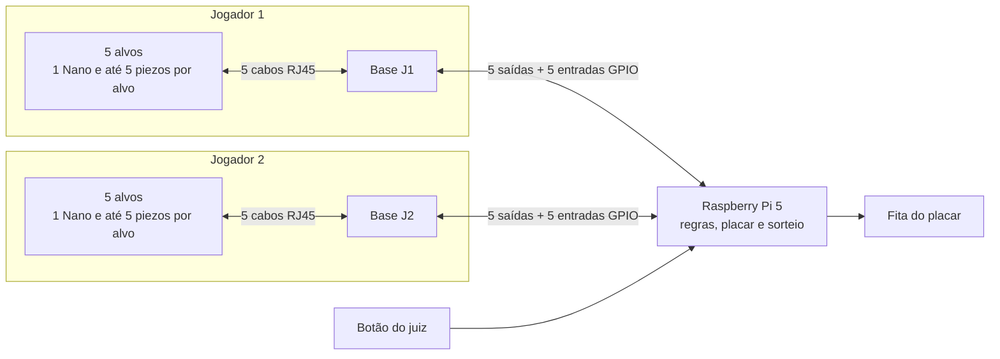
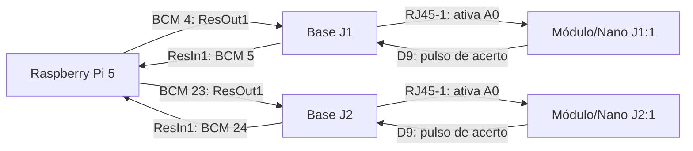

# AcerteZero

Protótipo de jogo competitivo para dois jogadores com placar em uma fita WS2812B controlada por Raspberry Pi 5.

Cada jogador tem cinco alvos; um alvo de cada lado fica ativo durante a partida. Um acerto válido ocupa um LED neutro ou toma um LED do adversário. As regras estão separadas das entradas físicas para permitir a troca de botões por outros sensores.

## Simulador

Na pasta do projeto, com o ambiente virtual da Pi ativado:

```bash
python -m acertezero.simulator --leds --led-count 31 --judge-button
```

Troque `31` pela quantidade real de LEDs. Digite `1 3`, por exemplo, para acionar o alvo 3 do jogador 1. Para simular dois acionamentos simultâneos, digite `1 3, 2 4` com os números dos alvos ativos. Se ambos acertarem, os dois alvos mudam e o território permanece igual. O botão do juiz fica entre GPIO 22 (pino físico 15) e GND; `r` simula esse botão pelo teclado e `s` encerra. Sem `--leds` e `--judge-button`, a simulação roda em um computador comum.

## LEDs dos alvos

O simulador aceita opcionalmente `--target-led-pins-j1` e `--target-led-pins-j2`, cada um com cinco números de GPIO BCM separados por vírgula, na ordem dos alvos 1 a 5. Os pinos serão definidos após a montagem; sem essas opções, somente a fita do placar acende. Com os dez LEDs configurados, no início e a cada reinício os dois lados fazem uma varredura 1→5→1, apagam brevemente e então acendem somente os dois alvos sorteados. Após um acerto, os alvos são atualizados sem repetir a animação.

As saídas são digitais ativas em nível alto. Use resistores ou drivers adequados aos indicadores escolhidos; não ligue lâmpadas de 5 V ou 12 V diretamente aos GPIOs. O GPIO 16 está reservado para a fita e o GPIO 22 para o botão do juiz quando `--judge-button` estiver ativo.

## Bases RJ45 com saídas GPIO (esquemáticos Arena Coca-Cola)

Os conectores RJ45 das placas proprietárias transportam **sinais elétricos e alimentação**, não mensagens TCP/IP. A recomendação para **reutilizar as placas sem modificar trilhas** é usar duas Bases, uma por jogador, e até cinco placas Módulo por Base, uma por alvo. Cada placa Módulo usa **um Nano para seus até cinco piezos**: o Nano junta as detecções em um único acerto daquele alvo. Com os dez alvos montados dessa forma, são dez Nanos. A Base não executa lógica: distribui 5 V e isola os sinais por optoacopladores.



O protocolo de cada alvo é propositalmente mínimo e **exige pinos separados para os dados da fita e o sinal de acerto**. A Pi escolhe os dois alvos ativos e coloca **apenas um `ResOut` por Base em nível alto**. O opto da Base transforma esse comando em `A0` baixo no Nano selecionado. O Nano acende a iluminação local pelo pino ligado a `BL` e só considera seus piezos enquanto `A0` estiver baixo. Ao detectar uma batida válida, põe sua saída `ArdOut` em nível alto por um pulso definido; o opto do Módulo transforma isso em `ResIn` baixo na Pi. A Pi registra o acerto, escolhe o próximo alvo e altera o placar. O Nano não conhece jogador, número de alvo nem pontuação: a posição do RJ45 na Base identifica o alvo.

| Sinal | Repouso | Ativo | Responsável |
| --- | --- | --- | --- |
| `ResOut` na Pi | baixo | alto | Pi seleciona um alvo por jogador. |
| `A0` no Nano | alto pelo resistor de 10 kΩ | baixo pelo opto da Base | Nano liga/apaga a iluminação local. |
| `ArdOut` no Nano | baixo | alto por um pulso após batida válida | Nano detecta toque. |
| `ResIn` na Pi | alto pelo resistor de 10 kΩ a 3,3 V | baixo pelo opto do Módulo | Pi recebe o acerto. |

O firmware mantém `ArdOut` alto **até a Pi desativar o alvo ou por no máximo 500 ms**. Essa duração cobre o debounce e a animação bloqueante do placar após um ponto; ela ainda precisa ser verificada no teste real. Um Módulo sinaliza no máximo um acerto por ativação. Não envie texto, ID ou pontuação entre Nano e Pi. Mantenha a calibração individual dos cinco piezos dentro de cada Nano.

**Por que não usar apenas um Nano por jogador com estas placas intactas?** Cada Módulo entrega à Base **um sinal digital de acerto**, produzido pelo opto após o Nano processar os piezos. Remover quatro Nanos por jogador exigiria redesenhar o caminho analógico dos piezos nos Módulos e na Base, inclusive os resistores e optoacopladores, ou refazer os chicotes. Levar sinais analógicos de piezo por cabos mais longos também exigiria nova validação contra ruído. Se a prioridade passar a ser reduzir o número de Nanos e houver liberdade para refazer essa eletrônica, a alternativa é **um Nano por jogador lendo cinco canais analógicos locais** e comunicação USB com a Pi; nesse caso, a Base proprietária deixa de ser a ponte prevista neste esquema. O [piloto USB preservado](./arduino/piezo_target_usb/piezo_target_usb.ino) é o ponto de partida para essa alternativa, mas sua fiação de sensores deve ser reavaliada.

| Caminho | Microcontroladores | Ligação à Pi | Quando escolher |
| --- | --- | --- | --- |
| **Reaproveitar Base e Módulos intactos (recomendado para estas placas)** | 1 Nano por alvo, até 10 | 10 entradas + 10 saídas GPIO | Placas já montadas e distribuição por RJ45 desejada. |
| **Simplificar o número de placas** | 1 Nano por jogador, 2 ao todo | 2 USB | Sensores podem ser ligados diretamente aos Nanos; Base/Módulos exigiriam retrabalho ou seriam retirados. |
| 1 Nano por jogador mantendo as placas intactas | Não viável pelo esquema atual | — | O opto de cada Módulo fornece um evento digital, não as cinco leituras analógicas ao Nano central. |

No conector de 13 vias da Base, a numeração do **esquemático** é:

| Pino | Rede | Função na Raspberry Pi |
| --- | --- | --- |
| 1 | `+3.3V` | Alimenta os pull-ups de 10 kΩ das cinco entradas. |
| 2, 4, 6, 8, 10 | `ResOut1..5` | Saídas GPIO, nível alto aciona o opto da Base e puxa a entrada `A0` do Módulo para baixo. |
| 3, 5, 7, 9, 11 | `ResIn1..5` | Entradas GPIO, repouso alto pelo pull-up de 3,3 V; o opto do Módulo puxa para baixo ao sinalizar acerto. |
| 12 | `GND` | Referência elétrica da Base e da Pi. |
| 13 | `+5V` | Mesma rede de alimentação dos RJ45 e do borne `CN1`; não ligar também ao `5V` da Pi quando houver fonte externa. |

Confirme a orientação física do pino 1 e cada fio do chicote com teste de continuidade; a posição vista na foto não garante a ordem dos fios. A Base usa um borne `CN1` para `+5V/GND`. Com fonte externa nesse borne, mantenha o pino 13 **isolado do 5 V da Pi**, conecte o GND (pino 12) e o 3,3 V (pino 1) da Pi nos lugares corretos. Dimensione a fonte externa para todos os Módulos conectados. Não conecte saídas ainda não medidas aos GPIOs: eles aceitam somente níveis de 0 a 3,3 V.

No esquema do Módulo, os piezos `BP1..BP5` chegam ao Nano em `A5, A1, A3, A2, A4`, respectivamente; `A0` recebe o comando da Base. O Nano envia um único sinal `ArdOut` de volta. O conector `BL` alimenta a fita endereçável do alvo: GND, +5 V e dados através de 470 Ω na rede legada `D9`, com um capacitor de 1000 µF na alimentação. O [firmware do piloto USB](./arduino/piezo_target_usb/piezo_target_usb.ino) lê `A0..A4` e envia `H,...` pela Serial, portanto **não corresponde a esta placa**.

**Pinos confirmados por continuidade na placa montada:** `D9 → ArdOut/RFA 330 Ω` e `D12 → BL/RL 470 Ω`. O esquema mostra `ArdOut` no contato **12** do conector `AR` e a rede denominada `D9` no contato **15**; esses números são posições do conector, não nomes dos pinos do Nano. O nome da rede da fita veio do projeto anterior. O [firmware do Módulo](./arduino/piezo_target/piezo_target.ino) usa os pinos físicos medidos.

Para repetir a medição, desconecte a fonte, USB, RJ45 e fita; retire o Nano do soquete. Antes de entrar no modo continuidade/Ω, confira em **V DC** que não há tensão entre `+5V` e `GND` da placa (há um capacitor de 1000 µF). Localize `RFA` de 330 Ω ao lado do opto e `RL` de 470 Ω perto de `BL`. Use sempre **a ponta do resistor voltada ao Nano**, identificada no esquema pela rede `ArdOut` ou `D9`; a outra ponta terá 330/470 Ω no caminho e pode não fazer o multímetro apitar. Encoste uma ponta no contato **D9 do soquete Nano** e a outra na ponta de `RFA`: anote se lê aproximadamente 0 Ω. Repita com a ponta de `RL`; depois faça os mesmos dois testes partindo do contato **D12**. D9→RFA e D12→RL devem medir próximo de 0 Ω, e as combinações cruzadas não. Por fim, teste diretamente D9↔D12: não devem estar em curto. Identifique D9 e D12 pela posição física no [pinout oficial](https://docs.arduino.cc/resources/pinouts/A000005-full-pinout.pdf), não pela numeração 12/15 do conector `AR` no desenho.

### Firmware de cada Módulo/Nano

Grave o mesmo [sketch do Módulo](./arduino/piezo_target/piezo_target.ino) em cada Nano. Instale a biblioteca **Adafruit NeoPixel** pelo Gerenciador de Bibliotecas da Arduino IDE. Antes de gravar, ajuste `TARGET_LED_COUNT` para a quantidade de LEDs do alvo, `TARGET_RED/GREEN/BLUE` para a cor desejada nesse jogador e `TARGET_BRIGHTNESS` para um brilho adequado à fonte. O padrão é **um LED com brilho baixo** para o primeiro teste; os dez Nanos podem compartilhar o mesmo firmware se as cores forem iguais, ou receber configurações de cor diferentes por jogador. O tipo de fita assumido é WS2812B/GRB a 800 kHz; se o modelo real tiver outra ordem de cores, altere `NEO_GRB`.

O array `PIEZO_PINS` mapeia `BP1..BP5 → A5,A1,A3,A2,A4`. Atualmente, `ENABLED` habilita apenas **BP2/A1**; habilite os demais somente após instalar os sensores, pois entradas soltas podem produzir falsos acertos. `TOUCH_DELTA` está em `25,25,50,50,25` para BP1..BP5, respectivamente; apenas o segundo valor participa da detecção com a configuração atual. **Calibre cada sensor na montagem nova**; os valores anteriores são apenas pontos de partida. A detecção continua usando a subida da média em janelas de 100 ms e o procedimento `c1` a `c5` pelo Monitor Serial a 115200 baud. Em cada Módulo, `c2` calibra **BP2**, não o alvo 2 do jogador. A Serial mostra `bateu BPn media=...` para diagnóstico; a Pi recebe o acerto exclusivamente por D9, não pela USB.

Teste um Módulo antes de repetir nos demais: com alimentação de 5 V correta e o circuito da Pi ainda desconectado, `A0` alto mantém os LEDs apagados; ligar temporariamente `A0` ao GND ativa a fita em D12. Uma batida num piezo habilitado deve imprimir `bateu BPn` no Monitor Serial e colocar D9 em nível alto por até 500 ms. Soltar `A0` apaga a fita e deixa D9 baixo. Faça o teste com **uma única fonte de 5 V** para o conjunto; não una indiscriminadamente o 5 V do USB e o 5 V de uma fonte externa. Depois confira na Base que o pulso faz `ResIn` cair de 3,3 V para 0 V. O programa da Pi só pontua se o alvo correspondente estiver ativo.

#### Teste de bancada sem Base nem Pi

1. Deixe **Base, Pi e fonte externa desconectadas**. Para o primeiro teste, mantenha `TARGET_LED_COUNT = 1` e brilho baixo. Conecte apenas o Nano pelo USB e confira em **V DC** se o Módulo recebe aproximadamente 5 V entre `+5V` e `GND`, inclusive no conector `BL`. No esquema, `BL` tem pino 1=GND, 2=+5 V e 3=dados; confirme a orientação física do conector por continuidade antes de ligar a fita. Se a alimentação não chegar ao Módulo pelo USB nessa placa, pare: não adicione uma segunda fonte de 5 V enquanto o USB estiver conectado sem antes planejar a isolação da alimentação. Instale uma fita curta com `DIN`, `+5V` e `GND` conferidos pela marcação da própria fita.
2. Abra o Monitor Serial em **115200 baud**, selecione **Nova linha** e espere `READY`. Envie `s`: deve aparecer `A0 fisico=HIGH; simulacao=OFF; alvo=inativo; D9=LOW`. Envie `l`: a fita de `BL` deve acender por três segundos e apagar sozinha. Esse teste usa D12 sem precisar ativar A0. O sinal de dados WS2812B não pode ser verificado por uma leitura de tensão DC no multímetro; observe os LEDs.
3. Com a ponta preta do multímetro no GND e a vermelha no D9 ou no lado de `RFA` voltado ao Nano, envie `t`. Espere aproximadamente **5 V por três segundos**, seguido de **0 V**. O comando `t` só funciona com A0 alto. Se quiser verificar também o opto sem a Base, ligue um resistor de **10 kΩ entre o 3,3 V do Nano e `RboOut`**; meça `RboOut` em relação ao GND. Ele deve ficar perto de **3,3 V** em repouso e de **0 V** durante `t`. Sem esse pull-up, `RboOut` fica flutuando e a medição não é conclusiva. Não ligue `RboOut` diretamente ao 3,3 V.
4. Meça A0 em relação ao GND: deve estar perto de **5 V** pelo resistor de 10 kΩ do Módulo. Envie `a` para **simular no firmware** a ativação do alvo sem adicionar resistor ou mudar eletricamente A0. A fita deve acender. Envie `s` e confirme `A0 fisico=HIGH; simulacao=ON; alvo=ativo; D9=LOW`. A0 permanece como entrada; o comando não testa o caminho elétrico Base → A0.
5. Para ver os piezos, envie `p`. A cada 100 ms surgem linhas `P,BPn,mínimo,média,máximo,saturadas,amostras`. Toque **BP2/A1**, o único canal habilitado atualmente, e confira que as leituras mudam. Envie `p` de novo para desligar o fluxo antes de testar os acertos. Com o alvo ativado pelo comando `a`, bata em BP2: espere `bateu BP2 media=...` e D9 alto por até 500 ms. Para repetir, envie `a` duas vezes (desativa e reativa), pois o firmware aceita no máximo um acerto por ativação. Ao terminar, envie `a` uma vez para desativar: a fita apaga e D9 fica baixo. Se não houver `bateu`, execute `c2` para calibrar BP2 e ajuste `TOUCH_DELTA[1]`.

Os comandos `l` e `t` só operam com o alvo inativo e sem calibração em curso. A mudança do estado do alvo cancela qualquer teste de bancada. `p` também funciona com o alvo inativo, sem sinalizar acertos; durante a calibração ele fica indisponível. `a` só funciona com A0 fisicamente alto e sem calibração; se a Base puxar A0 para baixo, ela assume o controle e desliga a simulação. Antes de conectar a Base, confirme `simulacao=OFF` com `s` ou reinicie o Nano. Use sempre o multímetro em **tensão DC**, nunca em corrente, para as medições de pinos energizados.

#### Teste da Base e de um Módulo antes de ligar os GPIOs da Raspberry Pi

Faça este teste depois do teste isolado acima, com **uma Base, um Módulo/Nano e uma fita curta**. Os RJ45 destas placas não são Ethernet de rede. Identifique por continuidade os fios do conector de 13 vias antes de energizar; não use a ordem visual dos fios como numeração. No esquemático da Base, `CN1` recebe `GND` no contato 1 e `+5V` no contato 2, mas confirme a orientação física e as marcas da placa antes de ligar a fonte.

1. Com tudo desligado, conecte uma **fonte regulada de 5 V** adequada à carga ao borne `CN1` da Base. Ligue uma fonte **regulada de 3,3 V** ao pino 1 do conector de 13 vias e seu GND ao pino 12. Pode ser um regulador 5 V → 3,3 V alimentado pela mesma fonte, desde que as saídas sejam medidas antes da ligação. O pino 13 do conector de 13 vias já pertence à rede de 5 V do borne; deixe-o isolado. Não conecte USB ao Nano ao mesmo tempo neste teste, nem a Raspberry. Não dependa do pino 3,3 V do Nano para alimentar a Base sem verificar como a placa o gera quando alimentada externamente.
2. Com a fonte ainda desligada, conecte o Módulo à porta `RJ45-1` da Base usando o cabo destinado a essas placas, mais a fita `BL` e o piezo BP2. Deixe os outros RJ45 livres. Ligue a fonte e meça, sempre em relação ao GND da Base: `CN1` e a alimentação do Módulo/Nano perto de **5 V**, pino 1 perto de **3,3 V**, `ResIn1` (pino 3) perto de **3,3 V**, e `A0` do Nano perto de **5 V**. A fita deve ficar apagada. Se alguma tensão estiver errada, desligue antes de continuar.
3. Desligue a fonte e prepare uma chave ou jumper **entre 3,3 V e `ResOut1` (pino 2)**. A placa já inclui um resistor de 330 Ω em série com o LED do optoacoplador dessa entrada; confirme por continuidade que está testando `ResOut1`. Ligue a fonte e feche a chave: `ResOut1` deve ir a 3,3 V, `A0` do Nano deve cair para perto de 0 V, e a fita do Módulo deve acender. Abra a chave: `A0` volta para perto de 5 V e a fita apaga. Se A0 não cair, confira o cabo RJ45, o resistor/opto da Base, GND e alimentação do Módulo. O comando Serial `a` não substitui este teste físico.
4. Para observar o retorno sem os GPIOs da Pi, ligue um **LED vermelho de teste com resistor de 1 kΩ em série** entre o 3,3 V e `ResIn1` (ânodo voltado ao 3,3 V; cátodo voltado ao `ResIn1`). O LED e o resistor podem ficar numa protoboard ligada apenas aos fios do conector da Base. Com `ResOut1` ativo, bata em BP2: o Nano deve produzir um pulso em D9, o opto do Módulo deve puxar `ResIn1` para perto de 0 V por até 500 ms e o LED de teste deve piscar. Para repetir, abra e feche `ResOut1`, pois o firmware aceita um acerto por ativação. Se tiver osciloscópio ou analisador lógico, observe `ResIn1` diretamente; um multímetro comum pode perder um pulso de 500 ms. Retire o LED de teste antes de conectar a Pi.

Os valores esperados são **5 V somente na alimentação e em A0**, e **0–3,3 V em `ResOut1`/`ResIn1`**. O teste de um canal confirma o caminho completo de `ResOut1 → A0 → fita/piezo → D9 → ResIn1`. Repita com cada RJ45 e com a segunda Base depois que o primeiro canal estiver estável. Para dimensionar a fonte do conjunto completo, some o consumo medido dos Nanos e dos LEDs; um WS2812B pode chegar a cerca de **60 mA por LED** em branco no brilho máximo ([guia da Adafruit](https://learn.adafruit.com/adafruit-neopixel-uberguide/powering-neopixels)).

**Se não houver regulador de 3,3 V:** use a Raspberry Pi 5 apenas para alimentar a rede de 3,3 V da Base durante este teste. Com **Pi e fonte da Base desligadas**, confirme primeiro que o pino 1 do conector da Base realmente é a rede `+3.3V` e que ela não tem continuidade com `+5V` (pino 13). Ligue o **pino físico 1 ou 17 (`3V3`) da Pi → pino 1 da Base** e um **pino físico GND da Pi, por exemplo o 6 → pino 12 da Base**. A fonte externa de 5 V continua exclusiva do borne `CN1`; mantenha o pino 13 da Base e todos os `ResOut`/`ResIn` desconectados da Pi. A chave manual do passo 3 pode ligar `ResOut1` ao mesmo 3,3 V da Base. Energize a Pi primeiro e depois a fonte da Base; ao terminar, desligue primeiro a fonte da Base. Meça novamente as tensões do passo 2 antes de acionar a chave. Assim a Pi participa eletricamente como fonte, mas nenhum GPIO de sinal é usado. Os cinco pull-ups de 10 kΩ da Base consomem no máximo aproximadamente 1,65 mA da rede de 3,3 V; o opto de uma saída ativa acrescenta alguns miliampères. Confira a pinagem física no [guia oficial da Raspberry Pi](https://www.raspberrypi.com/documentation/computers/raspberry-pi.html), pois seus GPIOs não toleram 5 V.

A [entrada GPIO do jogo](./acertezero/piezo_game.py) pode receber as cinco linhas `ResIn` de cada Base com `--input-gpios-j1` e `--input-gpios-j2` (números **BCM**, na ordem dos alvos). O sinal é tratado como ativo em nível baixo. `--input-debounce-ms` começa em 20 ms; o Nano deve manter o acerto por tempo maior do que esse valor mais o intervalo de leitura de 10 ms. Os `--target-led-pins-j1/j2` já existentes passam a representar as cinco saídas `ResOut` de cada Base; o jogo as ativa em nível alto. Use GPIOs distintos para as vinte linhas de entrada e saída, além dos GPIOs 16 (fita) e 22 (juiz). Só ligue a Pi após conferir que cada `ResIn` fica entre 0 e 3,3 V em repouso e durante o acionamento.

### Exemplo alternativo para dez alvos (ainda não montado)

Esta distribuição usa numeração **BCM**, não a posição física no conector de 40 pinos. Mantenha SPI da Pi desativado: os GPIOs 7–11 deste exemplo são compartilhados com SPI. Os GPIOs 2, 3, 14 e 15 ficam livres para I²C e UART; confirme que nenhum outro periférico usa as vinte linhas escolhidas.

| Base | `ResIn1..5` → GPIO BCM (pino físico da Pi) | `ResOut1..5` → GPIO BCM (pino físico da Pi) |
| --- | --- | --- |
| Jogador 1 | `5(29),6(31),12(32),13(33),19(35)` | `4(7),17(11),18(12),26(37),27(13)` |
| Jogador 2 | `20(38),21(40),23(16),24(18),25(22)` | `7(26),8(24),9(21),10(19),11(23)` |

Este exemplo de vinte sinais **não corresponde à montagem atual de dois alvos**: nela J2 usa `ResOut1 → BCM 23` e `ResIn1 → BCM 24`, enquanto aqui esses pinos aparecem em outras posições. Não o use sem refazer o mapeamento e conferir quais GPIOs estão livres. Além dessas vinte linhas, use GPIO 16 (pino físico 36) para a fita e GPIO 22 (pino físico 15) para o juiz. Cada Base precisa do seu pino 1 ligado ao **3,3 V** da Pi (pinos físicos 1 ou 17) e do pino 12 ao **GND** da Pi (por exemplo, pinos físicos 6 ou 9). Os pinos 13 (`+5V`) ficam isolados da Pi se os bornes `CN1` receberem a alimentação externa de 5 V. Não use um cabo Ethernet ligado à porta de rede da Pi: os RJ45 aqui apenas transportam alimentação e sinais discretos.

Antes de conectar os vinte sinais à Pi, faça a seguinte verificação em **cada Base**, com os sinais da Pi desligados: teste continuidade do chicote para identificar os pinos 1–13; confira polaridade e 5 V no borne `CN1`; depois conecte apenas o 3,3 V e o GND da Pi e meça cada `ResIn` em relação ao GND. Em repouso deve haver aproximadamente 3,3 V; quando o Módulo sinalizar, aproximadamente 0 V. Se aparecer 5 V, desligue tudo e revise a montagem. Ao comandar um `ResOut` pelo GPIO, confirme no Módulo que `A0` passa de aproximadamente 5 V para 0 V. Faça esse último teste somente depois de validar a orientação e as tensões da placa.

### Integração gradual com a Raspberry Pi

Comece com **uma Base e um Módulo/Nano na porta RJ45-1**, mantendo a fonte externa de 5 V no borne `CN1`. Com tudo desligado, retire a chave manual de `ResOut1` e o LED de teste de `ResIn1`. Mantenha a ligação já testada de `3V3` e `GND` entre Pi e Base. Confirme em tensão DC que `ResIn1` fica em cerca de 3,3 V em repouso e nunca recebe 5 V. Então ligue `ResIn1` (pino 3 da Base) ao **GPIO BCM 5 / pino físico 29** da Pi. Ainda não conecte `ResOut1` à Pi. Ligue a Pi antes da fonte externa da Base.

No terminal da Pi, teste a entrada sem executar o jogo:

```bash
sudo pinctrl 5 ip pu
sudo pinctrl poll 5
```

O estado deve ficar alto em repouso. Primeiro, com `ResIn1` confirmado entre 0 e 3,3 V, encoste brevemente **`ResIn1` no GND da Base**: o monitor deve mostrar **1 → 0 → 1**, testando fio e entrada da Pi sem depender do piezo. Depois, acione `ResOut1` com a chave manual de 3,3 V usada no teste anterior, bata no piezo **BP2/A1** do Módulo e observe outra transição breve **1 → 0 → 1** no GPIO 5. O Nano emite um único pulso de até 500 ms por ativação; abra e feche a chave para repetir. Se a ponte manual funcionar e a batida não, meça o pulso em `ResIn1` com um osciloscópio/analisador lógico, ou use o comando `t` no Nano somente com uma ligação USB de dados cuja alimentação de 5 V esteja isolada da fonte externa. Não conecte USB comum e alimentação externa de 5 V ao mesmo Nano sem confirmar a isolação da placa. Encerre `pinctrl poll` com Ctrl+C antes de executar Python. O [pinctrl oficial](https://github.com/raspberrypi/utils/blob/master/pinctrl/README.md) é uma ferramenta de diagnóstico e acessa os GPIOs diretamente.

Em seguida, com tudo desligado, retire a chave manual e conecte `ResOut1` (pino 2 da Base) ao **GPIO BCM 4 / pino físico 7** da Pi. Após ligar Pi e Base, teste a saída:

```bash
sudo pinctrl 4 op pn dl
sudo pinctrl 4 dh
sudo pinctrl 4 dl
```

No primeiro comando a fita do alvo fica apagada (`A0` perto de 5 V); no segundo acende (`A0` perto de 0 V); no terceiro apaga. Na montagem validada com a segunda Base, `ResOut1` usa **GPIO BCM 23 / pino físico 16** e `ResIn1` usa **GPIO BCM 24 / pino físico 18**. O GPIO BCM 7 / pino físico 26 também exerce a função SPI CE1; não o use neste piloto, já que a tentativa anterior encontrou esse pino ocupado.

#### Jogo piloto com apenas uma Base e um Módulo

**Para repetir o teste antigo com só a Base J1**, mantenha `ResIn1 → GPIO BCM 5` e `ResOut1 → GPIO BCM 4`, além de `3V3`, `GND` e 5 V externo no `CN1` como acima. Os GPIOs BCM 24 (entrada virtual de J2) e BCM 23 (saída virtual de J2) devem ficar **sem fio nenhum** nesse teste. O software configura a entrada vazia com pull-up interno, portanto ela permanece em repouso; a saída vazia não aciona nada. Com tudo desligado, retire qualquer chave manual de `ResOut1` e o LED de teste de `ResIn1` antes de conectar esses sinais à Pi.

Na pasta do projeto na Pi, atualize o código e rode o jogo em modo piloto. A fita do placar é opcional; sem `--leds`, a pontuação aparece no terminal:

```bash
git pull --ff-only
source ~/led-env/bin/activate
python -m acertezero.piezo_game --pilot \
  --input-gpios-j1 5 --target-led-pins-j1 4 \
  --input-gpios-j2 24 --target-led-pins-j2 23
```

O terminal mostrará `J1:1` e `J2:1`, mas **J2 é apenas virtual nesse teste**. Só a fita local do Módulo em `RJ45-1` deve acender. Bata em **BP2/A1**: `acertos J1` deve aumentar em uma unidade e a fita deve apagar por cerca de 30 ms para rearmar o Nano antes de acender de novo. Aguarde pelo menos 120 ms e bata novamente; o contador deve aumentar outra vez. `BP2` é o segundo piezo desse Módulo, enquanto `J1:1` é a posição RJ45-1 na Base. Não aperte o comando Serial `a` do Nano: a ativação agora precisa vir fisicamente de `ResOut1` da Pi. Ao encerrar com Ctrl+C, a saída é desligada e a fita local apaga.

Se a fita do placar já estiver ligada ao GPIO 16, acrescente `--leds --led-count 31` ao comando, trocando 31 pela quantidade real de LEDs. Cada batida deve mover o território uma posição a favor de J1. Com o botão do juiz já ligado ao GPIO 22/GND, acrescente também `--judge-button` e teste o reinício. Caso a fita local acenda mas não haja pontos, pare o jogo e repita `sudo pinctrl poll 5` com uma batida para verificar o pulso `ResIn1` antes de investigar o software.

Quando chegar a segunda Base, substitua os dois GPIOs virtuais pelos fios reais dela e passe ao teste dos dois jogadores descrito abaixo. Não conecte ainda os outros quatro Módulos de cada jogador: `--pilot` usa apenas a porta `RJ45-1` de cada Base.

#### Duas Bases e dois Módulos: um alvo por jogador

Cada **Módulo/Nano inteiro é um alvo do jogo**. Seus conectores `BP1..BP5` são até cinco pontos de impacto **dentro daquele mesmo alvo**; qualquer piezo habilitado nele envia o mesmo acerto `J1:1` ou `J2:1`. Neste piloto, conecte um Módulo à `RJ45-1` de cada Base. O firmware atual só habilita `BP2/A1`, portanto instale um piezo BP2 em cada Módulo. Grave o mesmo [firmware do Módulo](./arduino/piezo_target/piezo_target.ino) nos dois Nanos; ele não contém ID de jogador. Se quiser cores diferentes, ajuste `TARGET_RED/GREEN/BLUE` antes de gravar cada placa. Confira também `TARGET_LED_COUNT` para a fita local de cada alvo. Termine a gravação e retire o USB antes de alimentar os Módulos pelas Bases.



| Ligação no conector de 13 vias | Base J1 → Pi | Base J2 → Pi |
| --- | --- | --- |
| Pino 1, `+3.3V` | `3V3`, pino físico 1 ou 17 | `3V3`, pino físico 1 ou 17 |
| Pino 2, `ResOut1` | GPIO BCM 4, pino físico 7 | GPIO BCM 23, pino físico 16 |
| Pino 3, `ResIn1` | GPIO BCM 5, pino físico 29 | GPIO BCM 24, pino físico 18 |
| Pino 12, `GND` | GND da Pi | GND da Pi |
| Pino 13, `+5V` | Sem ligação com a Pi | Sem ligação com a Pi |

Com **tudo desligado**, confirme por continuidade a ordem real dos contatos dos dois chicotes e conecte `3V3`/`GND` da Pi às duas Bases. Uma fonte externa regulada de 5 V, dimensionada para os dois Nanos e as duas fitas locais, pode alimentar os bornes `CN1` das Bases **em paralelo**: `+5V` nos dois contatos `+5V`, negativo nos dois `GND`. Confirme a polaridade de cada borne na placa. O GND dessa fonte e o GND da Pi devem ser comuns; a ligação pelo conector da Base deve fornecer essa referência. Não ligue os pinos 13 das Bases ao 5 V da Pi e não deixe USB comum alimentando os Nanos ao mesmo tempo que a fonte externa. Conecte cada fita local ao `BL` do respectivo Módulo, conferindo `GND`, `+5V` e `DIN` pela placa e pela fita. Os outros RJ45 ficam vazios.

Valide **J2 isoladamente antes de ligar seus sinais GPIO à Pi**: com a fonte ligada, meça `+5V` e GND no Módulo, 3,3 V entre pinos 1 e 12 da Base, `ResIn1` (pino 3) perto de 3,3 V e `A0` do Nano perto de 5 V. Verifique que `ResIn1` nunca chega a 5 V. Com o jogo parado, ative `ResOut1` (pino 2) temporariamente com a mesma chave entre 3,3 V e `ResOut1` usada no teste da primeira Base. A fita de J2 deve acender; bata em BP2 e procure o pulso de `ResIn1`. Abra a chave para rearmar. Desligue tudo, retire a chave e só então conecte `ResIn1 → BCM 24` e `ResOut1 → BCM 23`. Para conferir a entrada, abra `sudo pinctrl poll 24` em um terminal, ative `ResOut1` em outro terminal e bata em BP2: espere a transição **1 → 0 → 1**. Para conferir a saída, execute em sequência `sudo pinctrl 23 op pn dl`, `sudo pinctrl 23 dh` e `sudo pinctrl 23 dl`; a fita local deve apagar, acender e apagar. Faça esses diagnósticos **sem o jogo Python em execução** e encerre `pinctrl poll` com Ctrl+C. Os GPIOs da Pi operam em 3,3 V e não toleram 5 V; pare se a medição de `ResIn1` estiver fora de 0–3,3 V ([documentação da Raspberry Pi](https://www.raspberrypi.com/documentation/computers/raspberry-pi.html)).

Depois de verificar os dois lados, ative o ambiente Python que já controla a fita e rode o **modo piloto**:

```bash
git pull --ff-only
source ~/led-env/bin/activate
python -m acertezero.piezo_game --pilot \
  --input-gpios-j1 5 --target-led-pins-j1 4 \
  --input-gpios-j2 24 --target-led-pins-j2 23
```

O terminal deve mostrar `J1:1` e `J2:1`, e **as duas fitas locais devem acender ao mesmo tempo**. Bata em BP2 de J1: apenas `acertos J1` aumenta; bata em BP2 de J2: apenas `acertos J2` aumenta. Repita cada lado depois que a fita local reacender. Bata nos dois quase ao mesmo tempo para verificar o lote simultâneo. O modo piloto sempre escolhe o alvo 1 de cada jogador; **BP2 é o segundo piezo dentro desse alvo**, não o alvo 2 do jogo. Para testar também o placar e o botão do juiz, acrescente `--leds --led-count 31 --judge-button` com a quantidade real de LEDs; o botão continua entre BCM 22 e GND. Ao chegar à vitória, os alvos apagam e o jogo aguarda o botão do juiz (se habilitado) ou Ctrl+C. Encerre o processo anterior antes de iniciar outro.

Se a fita local de J2 acender, mas J2 não pontuar, pare o jogo e confirme o pulso em `ResIn1`/BCM 24 ao bater em BP2. Se nenhuma das duas fitas acender, confira a alimentação de cada Base e os GPIOs de saída. Se apenas um lado pontuar, não troque os cabos dos jogadores para compensar: confira as ligações dessa Base e os números BCM passados ao comando.

Depois de montar os demais Módulos (um por `RJ45-2` a `RJ45-5` de cada Base), recalibre seus piezos e planeje o mapeamento de **dez entradas e dez saídas GPIO** antes da partida completa. O exemplo abaixo é um mapeamento **alternativo para dez alvos**: ele usa GPIO 7 e atribui GPIOs 23/24 a outras entradas de J2. Exige que GPIO 7 esteja disponível, inclusive com SPI desativado; **não o execute na montagem atual com J2:1 em GPIOs 23/24**. Os números das listas representam a ordem dos alvos 1 a 5 em cada Base.

```bash
source ~/led-env/bin/activate
python -m acertezero.piezo_game \
  --input-gpios-j1 5,6,12,13,19 --input-gpios-j2 20,21,23,24,25 \
  --target-led-pins-j1 4,17,18,26,27 --target-led-pins-j2 7,8,9,10,11 \
  --leds --led-count 31 --judge-button
```

Troque `31` pela quantidade real de LEDs da fita. Não execute esse comando como validação inicial de um chicote ainda desconhecido: ele aciona as saídas durante a animação de partida.

## Piezos: um Arduino Nano por jogador (piloto USB anterior)

Cada Nano lê cinco piezos em `A0` a `A4`. Grave o mesmo [sketch USB preservado](./arduino/piezo_target_usb/piezo_target_usb.ino) nas duas placas, com `PLAYER = 1` na primeira e `PLAYER = 2` na segunda. O alvo 1 corresponde a `A0`, o alvo 2 a `A1`, e assim até o alvo 5 em `A4`. Cada placa envia por USB linhas `H,jogador,alvo,leitura`, por exemplo `H,2,3,147`. A [entrada serial](./acertezero/serial_inputs.py) só aceita mensagens do jogador associado àquela porta. O [programa do jogo](./acertezero/piezo_game.py) reúne as duas fontes e o botão do juiz.

### Circuito de cada sensor

Monte **o mesmo circuito dez vezes**, cinco em cada Nano, com a alimentação desligada:

```text
piezo + ──┬── resistor 10 kΩ ── A0/A1/A2/A3/A4 do Nano
          │
       resistor 1 MΩ
          │
piezo - ──┴────────────────── GND do mesmo Nano
```

O resistor de **1 MΩ**, em paralelo com o piezo, oferece um caminho para descarregar a carga gerada pelo impacto. Sem ele, o sinal pode permanecer alto ou instável e gerar leituras erráticas. O valor é o do exemplo oficial de detecção de toque da Arduino. O resistor de **10 kΩ**, em série com a entrada analógica, limita a corrente dos picos positivos e negativos que um piezo pode produzir; ele não fixa a tensão num valor seguro por si só. Para impactos fortes ou fiação longa, adicione proteção/condicionamento apropriados, dimensionados após medir os picos reais. Comece com toques leves. Não ligue o piezo ao pino `5V`: ele gera o próprio sinal. Um resistor não tem polaridade; as marcações `+` e `-` no desenho são dos fios do piezo.

**Não substitua o resistor em série de 10 kΩ por 1 MΩ.** O resistor de 1 MΩ deve continuar **entre os dois fios do piezo**, e o de 10 kΩ entre o fio positivo e `A0` (ou outro canal). Um resistor de 1 MΩ em série não impõe um limite de tensão: a entrada do ADC consome pouca corrente e pode permanecer carregada ou captar ruído. O ADC do ATmega328P é otimizado para uma fonte de impedância de cerca de 10 kΩ ou menos; 1 MΩ em série dificulta a amostragem. Se você fez essa troca, desligue o Nano e restaure os dois resistores nas posições do desenho antes de calibrar.

O sinal do piezo pode oscilar, inclusive abaixo de 0 V e acima de 5 V. O ADC do Nano foi feito para ler tensões entre GND e sua referência, normalmente a alimentação de 5 V. O circuito acima é um ponto de partida para toques leves, não uma proteção validada para pancadas fortes. Antes de usar os alvos em competição, meça o pior impacto esperado (preferencialmente com osciloscópio) e dimensione um estágio de limitação/clamp que mantenha a entrada na faixa permitida. Não confie apenas nos diodos internos do microcontrolador para absorver a energia do piezo.

Cada Nano é alimentado pelo próprio cabo USB conectado à Pi. Não ligue os pinos `5V` dos Nanos à Pi, nem uma saída digital de 5 V do Nano diretamente a GPIOs da Pi. A fita WS2812B mantém sua fonte externa e o GND comum **entre fita, fonte e Pi**, como na montagem já validada; a comunicação Nano↔Pi passa pelos cabos USB.

### Montagem e calibração, em etapas

1. Ligue somente o piezo do alvo 1 em `A0` de cada Nano. No sketch, deixe `ENABLED = {true, false, false, false, false}`. Grave a versão `PLAYER = 1` no Nano J1 e depois mude para `PLAYER = 2` e grave no Nano J2. Na Arduino IDE, escolha a placa **Arduino Nano**, o processador/bootloader compatível com sua placa e a porta correspondente.
2. Teste uma placa de cada vez no Monitor Serial da Arduino IDE em **115200 baud**. Ao tocar o primeiro piezo do J1, espere `bateu` seguido de `H,1,1,media`; no J2, `bateu` seguido de `H,2,1,media`. O Nano ignora os primeiros 300 ms após ligar ou reiniciar. Uma batida válida produz um par de linhas; o evento `H` é o que a Pi entende. Feche o Monitor Serial antes de rodar Python, pois a porta só pode ser aberta por um programa de cada vez.
3. Com `PRINT_PEAKS = true`, observe `P,jogador,alvo,mínimo,média,máximo,saturadas,amostras` a cada 100 ms. Por exemplo, `P,1,1,0,12,1023,1,850` mostra **uma** amostra saturada em 850; não significa que o sinal ficou em 1023 durante toda a janela. O detector também usa médias de **100 ms**, calculadas por `diagnosticSum[index] / diagnosticCount[index]`: se a média subir **mais que o `TOUCH_DELTA` do canal** em relação à janela anterior, conta uma batida. A queda não conta. Após uma batida, espera no mínimo 120 ms e uma queda de pelo menos 25 na média antes de aceitar outra. `TOUCH_DELTA` é um array para ajustar separadamente A0..A4; o valor atual de A0 é 25, ajustado manualmente, e os demais são 50. `TOUCH_WINDOW_MS`, `REARM_DROP` e `REFRACTORY_MS` são comuns aos cinco sensores. Volte `PRINT_PEAKS` para `false` após calibrar: a impressão do diagnóstico serial consome tempo de amostragem. `1023` é o teto do ADC, não uma medida da tensão máxima que o piezo realmente gerou.
4. Acrescente os piezos de `A1` a `A4`, um de cada vez, com seus próprios resistores de 1 MΩ e 10 kΩ. Mude a posição correspondente em `ENABLED` para `true`, grave o sketch novamente e confirme no Monitor Serial que tocar `A3`, por exemplo, emite o alvo 4. Entradas sem sensor devem permanecer desabilitadas: uma entrada analógica solta pode flutuar e criar falsos toques.

#### Calibração rápida depois de mudar a montagem

1. Com a montagem pronta, abra o Monitor Serial em **115200 baud**, selecione **Nova linha** e envie `c1` para o alvo 1 (`c2` a `c5` para os demais alvos habilitados). Calibre um alvo por vez, em cada Nano. Envie `x` para cancelar. O comando funciona mesmo com `PRINT_PEAKS = false`.
2. Mantenha **todos os alvos parados por 10 segundos**. O Nano mede o menor e o maior valor médio e, principalmente, a maior **subida entre médias consecutivas de 100 ms** sem toque. Evite movimentar os cabos nesse período, a menos que queira incluir essa perturbação típica no teste.
3. Quando solicitado, **aproxime e afaste rapidamente a mão ou o dedo por 10 segundos**, repetidas vezes, nas posições em que as pessoas podem passar durante o jogo. Faça isso perto do sensor e dos fios, **sem encostar** em nenhum deles ou no alvo. O Nano mede separadamente a maior subida causada por essa aproximação. Depois, afaste a mão e aguarde a pausa de 1 segundo.
4. Quando aparecer `CAL: bata no alvo`, faça **uma batida em até 4 segundos**, com a menor intensidade que ainda deve contar no jogo. Repita cinco vezes, aguardando a pausa de 1 segundo indicada entre tentativas. O Nano registra a maior subida da média em cada tentativa, sem emitir eventos `H` durante a calibração.
5. Leia `CAL: sugestao TOUCH_DELTA[n] = valor`. O índice `n` começa em zero: alvo 1 → `[0]`, alvo 5 → `[4]`. Copie cada valor para o array `TOUCH_DELTA`, grave o sketch novamente e teste batidas reais e aproximações sem contato. A sugestão fica acima da maior subida entre **repouso e aproximação**, com margem, e abaixo da menor subida das cinco batidas. Se aparecer `sem limiar confiavel`, alguma batida não foi capturada ou as faixas se sobrepõem: confira a montagem, repita o teste e considere ajustar a janela ou o condicionamento do sinal.

A calibração mede a **mesma variação de média** usada pelo detector, mas 10 segundos de repouso e 10 segundos de aproximação não garantem ausência de falsos positivos em todas as condições. Faça o teste com o restante do equipamento ligado e observe o comportamento por mais tempo após aplicar os valores. Se aproximar a mão produzir uma variação semelhante à de uma batida, um único limiar não conseguirá distinguir os dois casos: revise a fiação, a fixação do sensor e o condicionamento do sinal. Se houver amostras em `1023`, confira a proteção elétrica: `TOUCH_DELTA` não limita a tensão no pino.

Fixe cada piezo no alvo de forma repetível, prenda os fios para que não puxem o disco e, se alvos vizinhos vibrarem juntos, afaste ou isole mecanicamente as superfícies antes de compensar apenas com limiares maiores. Teste batidas fracas, fortes e rápidas; uma batida deve gerar uma mensagem, duas batidas separadas pelo intervalo escolhido devem gerar duas, e bater em um alvo não deve acionar outro. Cabos longos perto da alimentação da fita podem captar ruído: mantenha o retorno GND junto do sinal de cada sensor e separe esses cabos dos fios de potência.

Os cinco canais são lidos em sequência por `analogRead()`. A decisão usa a média de **100 ms**. Essa janela pode diluir batidas breves: um pulso curto pode não elevar a média acima do `TOUCH_DELTA` do canal, mesmo que `P` mostre um pico alto. Se isso acontecer, será necessário alongar/capturar o pulso no circuito analógico, reduzir a janela ou rever a taxa de amostragem. Batidas separadas por menos de `REFRACTORY_MS` são propositalmente tratadas como uma só. O valor ADC enviado em `H` é a **média da janela que detectou a batida**, não a força nem a tensão máxima real do piezo.

### Se aparecer 1023 com frequência

1. Confira **qual linha** você está lendo: `P` é um resumo de 100 ms; `H` leva a média de 100 ms que disparou a batida. O sketch inicial enviava a primeira amostra que cruzava um limiar fixo; por isso, seus valores de `H` frequentemente ficavam perto daquele limiar.
2. Com o circuito restaurado e sem tocar no alvo por alguns segundos, observe `mínimo`, `média` e `saturadas`. Se só `máximo` chegar a `1023` ocasionalmente, houve um pico breve. Se `média`, `mínimo` e quase todas as amostras estiverem em `1023`, a entrada está alta de forma contínua: revise a ligação do GND, a posição do resistor em paralelo e se `A0` não foi ligado ao `5V` por engano. Uma entrada já alta no início não deve produzir `bateu` porque a primeira janela apenas estabelece a referência.
3. Para isolar o ADC, desligue o Nano, remova a ligação do piezo e do resistor em série de `A0`, ligue **somente `A0` ao GND por um resistor de 10 kΩ**, religue e observe `P`. Mínimo/média/máximo devem ficar próximos de zero e `saturadas` deve ser zero. Se não ficarem, confira o pino escolhido, os fios e a placa antes de recolocar o piezo.
4. Se o repouso estiver perto de zero, mas toques leves já saturarem, não tente corrigir apenas aumentando `TOUCH_DELTA` nem trocando 10 kΩ por 1 MΩ. O parâmetro decide **quando contar**; não reduz a tensão do pico. Meça o sinal e acrescente um estágio de proteção/limitação dimensionado para esse alvo. Até lá, use somente toques leves no protótipo. Se as variações em repouso ou ao aproximar a mão também passarem do `TOUCH_DELTA` do canal, melhore a fiação/montagem e repita a calibração; se toques legítimos não forem detectados, verifique a duração do pulso e considere uma janela menor.

### Reduzindo falsos positivos

1. **Meça interferências antes de mudar o limiar.** Use a calibração guiada acima; para uma validação mais longa, observe o alvo montado e imóvel por 1–2 minutos, depois repita a aproximação sem contato. Anote a maior subida entre médias `P` consecutivas de 100 ms e quantas janelas têm amostras saturadas. Faça depois várias batidas fracas que *devem* contar e anote a menor subida. Escolha `TOUCH_DELTA` acima da maior variação sem toque, com margem, e abaixo da menor batida desejada. Os valores atuais são pontos de partida. A [Arduino recomenda ajustar o limiar à intensidade observada](https://docs.arduino.cc/built-in-examples/sensors/Knock/).
2. **Corrija a entrada antes de filtrar por software.** Confirme o 1 MΩ em paralelo, o resistor de 10 kΩ em série, o GND do mesmo Nano e os canais não conectados desabilitados. Evite fios analógicos longos próximos aos fios de alimentação da fita; mantenha sinal e retorno próximos. A [Microchip recomenda caminhos analógicos curtos e afastados de sinais digitais rápidos](https://ww1.microchip.com/downloads/en/DeviceDoc/Atmel-7810-Automotive-Microcontrollers-ATmega328P_Datasheet.pdf). Se `P` já muda muito sem toque, elevar o tempo refratário só esconderá sintomas.
3. **Isole vibrações mecânicas.** Fixe o disco e a superfície do alvo firmemente; verifique se movimentos da mesa, alvos vizinhos, objetos soltos ou som forte produzem eventos. A [Adafruit documenta esses falsos acionamentos em sensores de batida](https://learn.adafruit.com/secret-knock-activated-drawer-lock/testing). Separe mecanicamente os alvos antes de compensar apenas elevando o limiar.
4. **Observe o formato das batidas.** A janela de 100 ms pode reduzir a variação da média de impactos curtos. Se o maior ruído em repouso e o menor toque real ficarem na mesma faixa, um limiar único não resolverá. Nesse caso, considere condicionamento analógico para prolongar o sinal ou volte a uma janela menor após estabilizar a montagem. `REFRACTORY_MS` e `REARM_DROP` ajudam contra repetições da mesma batida; não distinguem vibração externa de uma batida intencional.

### Teste na Raspberry Pi

Na Pi, tenha uma cópia atualizada deste repositório e execute os comandos **na pasta do projeto**, com o ambiente Python já usado para a fita. Conecte os dois Nanos por cabos USB de dados. Confira que o sketch gravado no Nano J1 tem `PLAYER = 1` e o do J2 tem `PLAYER = 2`. As portas podem ser `/dev/ttyUSB0` e `/dev/ttyUSB1`, ou `/dev/ttyACM0` e `/dev/ttyACM1`; não presuma qual pertence a cada jogador. Prefira os nomes persistentes em `/dev/serial/by-id/` quando distinguirem as placas. Se as placas iguais não aparecerem com nomes distintos, confira `/dev/serial/by-path/` e mantenha cada Nano na mesma porta USB física.

```bash
source ~/led-env/bin/activate
python -m pip install pyserial
python -m serial.tools.list_ports -v
ls -l /dev/serial/by-id/
ls -l /dev/serial/by-path/
id -nG
```

Se abrir a porta causar `Permission denied`, confira o grupo do dispositivo com `ls -l /dev/ttyUSB0` (troque pelo nome detectado). Se o grupo for `dialout` e ele não aparecer em `id -nG`, execute `sudo usermod -aG dialout "$USER"`, encerre a sessão da Pi e entre novamente antes de testar. Não use `sudo` para executar o jogo nem altere a permissão do dispositivo a cada conexão.

Para identificar J1 e J2, abra **uma porta por vez** com `python -m serial.tools.miniterm /dev/ttyUSB0 115200`, toque o piezo e confira se a linha começa com `H,1,` ou `H,2,`. O Nano pode reiniciar ao abrir a porta; espere a mensagem `READY` e os 300 ms de inicialização. Feche o miniterm antes de abrir a mesma porta em outro programa e repita na segunda porta. `P,...`, `bateu` e `CAL:...` são mensagens de diagnóstico; a Pi processa apenas `H,jogador,alvo,media`.

Depois, confira **as duas portas ao mesmo tempo**, sem iniciar a partida:

```bash
python -m acertezero.piezo_monitor --port-j1 /dev/ttyUSB0 --port-j2 /dev/ttyUSB1
```

Substitua os caminhos pelas portas identificadas. Cada batida deve mostrar `Recebido: jogador 1, alvo N` ou `Recebido: jogador 2, alvo N`. O monitor valida o número do jogador em cada porta e aceita alvos 1 a 5, mesmo quando há apenas um piezo montado. Na versão local usada durante a integração, apenas `A4` está habilitado; nesse caso espere `alvo 5`. Encerre com `Ctrl+C` antes de abrir o jogo.

Com apenas `A0` conectado e habilitado em **cada** Nano, faça o teste inicial do jogo no terminal, sem fita:

```bash
python -m acertezero.piezo_game --port-j1 /dev/ttyUSB0 --port-j2 /dev/ttyUSB1 --pilot
```

No modo `--pilot`, há um alvo ativo por jogador, sempre o alvo 1. Toque J1:1 e veja `acertos J1` aumentar; toque J2:1 e veja `acertos J2` aumentar. Quando ambos tocam quase juntos, os dois acertos são registrados e o território fica igual. Se nenhum dos dois pontuar apesar de os Nanos enviarem `H,...`, confira se as portas foram invertidas: o programa rejeita uma mensagem de J2 na porta informada como J1, e vice-versa. Para acender a fita e usar o botão do juiz, acrescente `--leds --led-count 31 --judge-button` (ajuste `31` à fita). O botão continua no GPIO 22; a fita, no GPIO 16. Pressione o botão do juiz e confirme que a divisão inicial reaparece.

**Atenção:** `--pilot` aceita apenas mensagens do alvo 1 (`A0`). Com somente `A4` habilitado, use o monitor acima para testar a recepção serial; para pontuar no modo piloto, habilite e conecte `A0` em cada Nano.

Depois de validar os dez sensores, rode a partida completa **sem** `--pilot`. O terminal mostra um alvo ativo por jogador; toques em alvos apagados não pontuam. Se já tiver ligado os dez indicadores dos alvos aos GPIOs da Pi, acrescente `--target-led-pins-j1` e `--target-led-pins-j2`, com cinco GPIOs BCM em cada lista, na ordem dos alvos 1 a 5. As duas listas são obrigatórias juntas e não podem repetir GPIOs nem usar GPIO 16 ou 22. Sem essas opções, os alvos ativos aparecem apenas no terminal.

```bash
python -m acertezero.piezo_game --port-j1 /dev/ttyUSB0 --port-j2 /dev/ttyUSB1 --leds --led-count 31 --judge-button
```

A Pi agrupa eventos recebidos das duas portas durante 30 ms antes de processar o lote. Isso ajuda a tratar toques próximos como simultâneos, mas não oferece sincronização exata entre os relógios dos Nanos e o agendamento USB/Linux. Para competição com exigência rigorosa de simultaneidade, será necessário medir a latência real e definir uma regra temporal mais precisa.

## Testes e contexto

```bash
python -m unittest discover -s tests -v
```

O histórico técnico, as ligações já validadas e as integrações pendentes estão em [CONTEXTO.md](./CONTEXTO.md).
